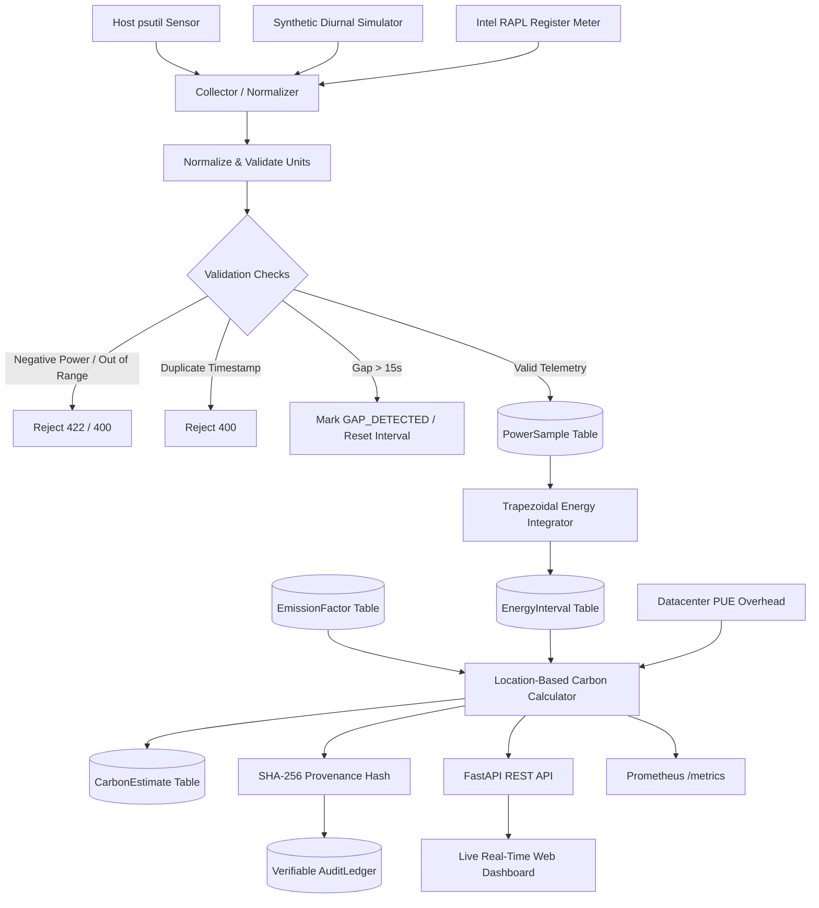

# Energy-to-CO₂ Translation Engine

[](https://www.python.org/downloads/)
[](https://fastapi.tiangolo.com/)
[](https://prometheus.io/)
[](LICENSE)
[]()

> An auditable, unit-safe telemetry translation microservice that converts instantaneous power draws (Watts) into time-integrated energy (Wh / kWh) and location-specific greenhouse gas estimates ($gCO_2e$) with end-to-end cryptographic provenance.

---

## 📑 Table of Contents
- [Problem Statement & Real-World Context](#problem-statement--real-world-context)
- [System Architecture & Data Flow](#system-architecture--data-flow)
- [Mathematical Formulation & Unit Safety](#mathematical-formulation--unit-safety)
- [Database Schema & Design](#database-schema--design)
- [REST API & Prometheus Metrics](#rest-api--prometheus-metrics)
- [Live Interactive Web Dashboard](#live-interactive-web-dashboard)
- [Controlled Stress-Test Experiment (Milestones M4/M5)](#controlled-stress-test-experiment)
- [Security, Idempotency & Edge-Case Handling](#security-idempotency--edge-case-handling)
- [Evaluation, Demo Script & Limitations](#evaluation-demo-script--limitations)
- [Local Setup & Docker Deployment](#local-setup--docker-deployment)

---

## Problem Statement & Real-World Context
Modern cloud observability platforms (e.g., Datadog, Prometheus, Grafana, CloudWatch) monitor CPU utilization, memory pressure, and network throughput, but typically lack a consistent, verifiable estimate of actual electricity consumption and location-specific greenhouse gas emissions.

**Target Personas:**
- **Platform & SRE Teams:** Quantifying operational carbon footprints of server clusters and Kubernetes nodes.
- **Sustainability Analysts:** Exporting verifiable Scope 2 carbon accounting reports with audited factor provenance.
- **Application Developers:** Measuring the marginal energy cost of computational tasks, ML training runs, or heavy batch jobs.

---

## System Architecture & Data Flow



### Request & Processing Flow:
1. **Sample Ingestion:** Ingests instantaneous Watts, host identifier, source label, and UTC timestamp.
2. **Gap Detection:** Compares $\Delta t$ against prior sample. If $\Delta t > 15.0\text{s}$, isolates interval as `GAP_DETECTED` to prevent spurious energy accumulation across offline periods.
3. **Trapezoidal Integration:** Calculates interval Watt-hours ($Wh$) and kilowatt-hours ($kWh$) via mathematical trapezoid rule.
4. **Regional Emission Attachment:** Looks up grid emission intensity ($gCO_2e/kWh$) for the active region (e.g., US-EAST, EU-NORTH, IN-SOUTH) and applies datacenter PUE overhead.
5. **Traceability & Ledger:** Generates a deterministic SHA-256 hash containing all computation parameters and commits the transaction to an append-only audit ledger.
6. **Live Distribution:** Exposes REST endpoints, Prometheus gauges/counters, and websocket/polling feeds to the UI.

---

## Mathematical Formulation & Unit Safety

### 1. Separation of Power ($W$) vs Energy ($Wh$, $kWh$)
A common trap in sustainability tooling is confusing instantaneous power draw ($W = \text{Joules/second}$) with cumulative energy consumed ($Wh = \text{Joules} / 3600$).

$$\text{Energy}_{\text{trapezoidal}} (Wh) = \left(\frac{P_1 + P_2}{2}\right) \times \left(\frac{\Delta t}{3600}\right)$$

$$kWh = \frac{Wh}{1000}$$

### 2. Location-Specific Greenhouse Gas Calculation
$$\text{Carbon} (gCO_2e) = kWh \times \text{PUE} \times \text{Emission\_Factor}_{\text{region}}\left(\frac{gCO_2e}{kWh}\right)$$

$$kgCO_2e = \frac{gCO_2e}{1000}, \quad \text{Metric Tons } CO_2e = \frac{kgCO_2e}{1000}$$

### 3. Regional Grid Carbon Intensities Supported:
- **US-EAST (PJM Interconnection):** $380.5\text{ gCO}_2e/kWh$
- **US-WEST (CAISO California):** $210.0\text{ gCO}_2e/kWh$
- **EU-CENTRAL (Germany / Continental Grid):** $315.0\text{ gCO}_2e/kWh$
- **EU-NORTH (Nordic Clean Hydro / Wind):** $45.0\text{ gCO}_2e/kWh$
- **IN-SOUTH (India CEA Baseline Grid):** $630.0\text{ gCO}_2e/kWh$
- **AU-EAST (Australia NEM):** $550.0\text{ gCO}_2e/kWh$

---

## Database Schema & Design

The relational SQLite/PostgreSQL schema enforces strict data integrity:

| Entity | Fields | Description |
| :--- | :--- | :--- |
| **`PowerSample`** | `id`, `host`, `timestamp` (indexed), `power_w`, `source`, `quality`, `created_at` | Raw telemetry points with host and source provenance. |
| **`EnergyInterval`** | `id`, `host`, `start_at`, `end_at`, `duration_seconds`, `energy_wh`, `energy_kwh`, `method`, `start_sample_id`, `end_sample_id` | Integrated time slices with verified trapezoidal area. |
| **`EmissionFactor`** | `id`, `region` (indexed), `valid_at`, `gco2e_kwh`, `source`, `is_active` | Official grid carbon intensity factors with validity timestamps. |
| **`CarbonEstimate`** | `id`, `interval_id`, `factor_id`, `region`, `pue`, `energy_kwh`, `grams_co2e`, `model_version`, `provenance_hash` | Location-specific carbon calculation with immutable audit hash. |
| **`AuditLedger`** | `id`, `idempotency_key`, `event_type`, `host`, `payload_hash`, `details`, `created_at` | Append-only ledger recording all telemetry mutations & stress tests. |

---

## REST API & Prometheus Metrics

### Core REST Endpoints:
- `GET /health`: Engine uptime, model version, database connection state, ingested sample count.
- `POST /telemetry`: Ingest raw power reading with optional `Idempotency-Key` header and target `region`.
- `GET /energy/summary`: Cumulative energy ($Wh$, $kWh$), duration, and interval count.
- `GET /carbon/summary?region=US-EAST&pue=1.20`: Location-specific emissions with explicit formula breakdown.
- `GET /carbon/timeseries?region=...&limit=60`: Real-time chart-ready telemetry stream.
- `GET /regions`: Supported regional grids and emission intensities.
- `POST /regions`: Add or update custom regional factors with audit tracking.
- `POST /simulate/stress-test`: Trigger controlled multi-stage workload experiment.
- `GET /simulate/status`: Real-time status, stage indicator, and comparative report of running experiment.
- `GET /audit/ledger`: Cryptographic audit records with payload hashes.
- `GET /metrics`: Standard Prometheus scraping endpoint.

### AWS Cloud Carbon Endpoints:
- `GET /aws/instances`: List EC2 instance types (`c6i.4xlarge`, `c7g.4xlarge`, `g5.2xlarge`, `t4g.xlarge`, `p4de.24xlarge`) with vCPU, RAM, architecture, idle Watts, and max TDP.
- `GET /aws/regions`: List supported AWS regions with their carbon grid intensity factors (`us-east-1`, `eu-north-1`, `ap-south-1`, etc.).
- `POST /aws/optimize`: Calculate spatial carbon arbitrage, green-shifting savings percentage, and equivalent trees/miles saved.
- `POST /aws/inject-telemetry`: Stream simulated EC2 workload power telemetry directly into the live engine.

### Exported Prometheus Metrics:
- `energy_power_watts`: Gauge of instantaneous draw labeled by `host`, `source`, and `type` (`measured` vs `simulated`).
- `energy_watthours_total`: Counter of accumulated electrical energy in Wh.
- `energy_kilowatthours_total`: Counter of accumulated energy in kWh.
- `carbon_emissions_grams_total`: Counter of cumulative greenhouse gas emissions labeled by `region`.
- `carbon_grid_intensity_gco2e_kwh`: Gauge of grid carbon intensity factor.
- `carbon_emission_rate_grams_per_hour`: Gauge of instantaneous carbon emission velocity.
- `telemetry_samples_total`: Counter of ingested samples labeled by `host` and `source`.
- `telemetry_gaps_total`: Counter of discontinuous sample intervals detected.

---

## Live Interactive Web Dashboard

Access the real-time responsive dashboard at `http://localhost:8000/`:

1. **Live Telemetry Stream:** Instantaneous power readings sampled via `psutil` or synthetic generator.
2. **Dynamic KPI Metrics Cards:** Real-time updates for Watts, integrated Wh/kWh, location-specific $gCO_2e$, and equivalent smartphone charges.
3. **Interactive Grid Region Switcher:** Switch between US-EAST, US-WEST, EU-CENTRAL, EU-NORTH, IN-SOUTH, and AU-EAST with instantaneous recalculation.
4. **PUE Overhead Slider:** Dynamically adjust Datacenter Power Usage Effectiveness from 1.0 (ideal) to 2.0 (legacy facility).
5. **Real-time Dual Charts:**
   - Power Telemetry Time Series (Watts)
   - Cumulative Energy ($Wh$) vs Cumulative Greenhouse Gas ($gCO_2e$)
   - Cross-regional emissions spatial variance comparison
6. **Verifiable Audit Ledger View:** Live table displaying deterministic transaction IDs, timestamps, payload SHA-256 hashes, and formula parameters.

---

## Controlled Stress-Test Experiment
*(Milestone M4 & M5 Acceptance Criteria)*

The built-in experiment engine allows operators to trigger reproducible workload transitions:
1. **Stage 1 (Baseline Idle):** Idle workload at ~30–40W.
2. **Stage 2 (Traffic Spike):** Impulse surge up to ~110–130W.
3. **Stage 3 (Sustained Heavy Load):** Sustained target saturation (e.g. 85%).
4. **Stage 4 (Cooldown & Recovery):** System load drops back to idle baseline.

**Comparative Impact Report:**
Automatically calculates and displays:
- Average baseline idle power (W)
- Average peak power (W)
- Percentage power draw increase
- Total delta energy consumed ($Wh$)
- Total delta carbon emitted ($gCO_2e$)
- Verifiable state transition audit entry with cryptographic hash.

---

## Security, Idempotency & Edge-Case Handling

- **Idempotency Safeguard:** Mutating calls accept an `Idempotency-Key` header. Duplicate submissions within 24 hours return `409 Conflict` with the prior transaction reference.
- **Timestamp Validation:** Strictly enforces UTC timezone normalization; rejects duplicate timestamps for the same host (`400 Bad Request`).
- **Range & Value Safety:** Rejects negative Watts ($P < 0$) and absurd power draws ($P > 100,000W$) with `422 Unprocessable Entity`.
- **Gap Isolation:** Any sample gap $\Delta t > 15.0s$ triggers explicit gap detection, resetting the trapezoid integration window to prevent synthetic energy attribution during downtime.
- **Concurrent SQLite Optimization:** SQLite configured with WAL mode (`PRAGMA journal_mode=WAL`), 30-second busy timeout, and connection pooling.

---

## Evaluation, Demo Script & Limitations

### Demo Script (Step-by-Step for Presentations):
1. **Show Architecture & Input Source:** Open dashboard at `http://localhost:8000/` and note the instantaneous Watts and psutil host meter source.
2. **Record Baseline Metrics:** Note baseline power (~35W) and low emissions.
3. **Change One Condition (Grid Intensity):** Switch dropdown from **US-EAST** (380.5 g/kWh) to **EU-NORTH** (45.0 g/kWh). Observe instantaneous ~88% reduction in carbon emissions for the exact same energy footprint.
4. **Run Controlled Experiment:** Select 15s or 30s duration and click **"Run Stress Experiment"**. Watch the active stage progress bar transition from Baseline -> Spike -> Sustained -> Cooldown.
5. **Inspect Comparative Audit Record:** Review the generated comparative statistics card and corresponding cryptographic audit ledger row.
6. **Examine Prometheus Metrics:** Visit `http://localhost:8000/metrics` to verify scrapeability.

### System Limitations:
1. **Shared Host Attribution:** On virtualized shared multi-tenant hosts, OS-level CPU metrics cannot isolate memory bus or co-located tenant power draws without hypervisor telemetry.
2. **Static Grid Factors:** Regional factors in MVP represent annual or seasonal grid averages (EPA eGRID / CEA / EEA); real-time 5-minute marginal grid emissions require third-party API keys (e.g. WattTime or Electricity Maps).
3. **Intel RAPL Availability:** RAPL direct hardware register access requires Linux kernel with read privileges on `/sys/class/powercap/intel-rapl`. On Windows/macOS, engine uses validated empirical modeling.

---

## Local Setup & Docker Deployment

### 1. Local Python Setup
```bash
# Clone and enter workspace
git clone <repo-url>
cd "Energy to CO2"

# Create virtual environment and install dependencies
python -m venv .venv
.venv\Scripts\activate      # Windows
# source .venv/bin/activate # Linux / macOS
pip install -r requirements.txt

# Run pytest verification suite (18 tests)
pytest -v

# Start the translation engine
uvicorn app.main:app --host 0.0.0.0 --port 8000 --reload
```

### 2. Docker Deployment
```bash
# Build and run with Docker Compose (Engine + Prometheus)
docker compose up -d

# Verify services:
# - Web Dashboard: http://localhost:8000
# - OpenAPI Docs:  http://localhost:8000/docs
# - Prometheus:    http://localhost:9090
```
