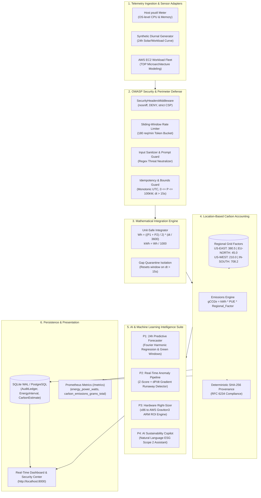
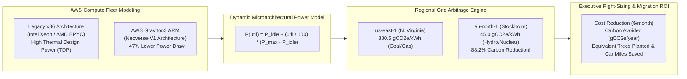
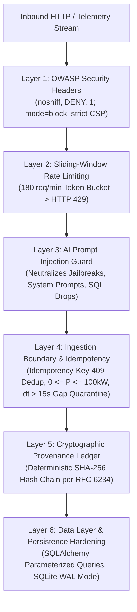

# Energy-to-CO₂ Translation Engine

[](https://www.python.org/downloads/)
[](https://fastapi.tiangolo.com/)
[](https://prometheus.io/)
[](LICENSE)
[]()
[]()
[]()
[]()

> **An auditable, unit-safe telemetry translation microservice that converts instantaneous power draws (Watts) into time-integrated electrical energy (Wh / kWh) and location-specific greenhouse gas estimates ($gCO_2e$) with end-to-end cryptographic provenance, AWS cloud hardware right-sizing, AI predictive intelligence, and enterprise-grade OWASP security.**

---

## 📑 Table of Contents
- [Problem Statement & Real-World Context](#problem-statement--real-world-context)
- [End-to-End System Architecture](#end-to-end-system-architecture)
- [AWS Cloud Architecture & Role](#aws-cloud-architecture--role)
- [AI & Machine Learning Capabilities](#ai--machine-learning-capabilities)
- [Enterprise Security, Compliance & Governance](#enterprise-security-compliance--governance)
- [Mathematical Formulation & Unit Safety](#mathematical-formulation--unit-safety)
- [Database Schema & Design](#database-schema--design)
- [REST API & Prometheus Metrics](#rest-api--prometheus-metrics)
- [Live Interactive Web Dashboard](#live-interactive-web-dashboard)
- [Controlled Stress-Test Experiment (Milestones M4/M5)](#controlled-stress-test-experiment)
- [Evaluation, Demo Script & Limitations](#evaluation-demo-script--limitations)
- [Local Setup, 24/7 Daemon & Docker Deployment](#local-setup-247-daemon--docker-deployment)

---

## Problem Statement & Real-World Context
Modern cloud observability platforms (e.g., Datadog, Prometheus, Grafana, AWS CloudWatch) monitor CPU utilization, memory pressure, and network throughput, but **lack a consistent, verifiable estimate of actual electricity consumption and location-specific greenhouse gas emissions**. 

Monitoring tools routinely state that a node is running at *72% CPU utilization*, but they cannot answer:
1. *How many kilowatt-hours did this microservice burn today?*
2. *What is the exact greenhouse gas footprint given the active regional power grid?*
3. *How much carbon and cloud cost would be eliminated by migrating to energy-efficient ARM processors like AWS Graviton3?*
4. *Can an external ESG auditor verify the mathematical provenance of these carbon figures without relying on proprietary black boxes?*

This engine translates low-level hardware and cloud telemetry into explicit, traceable, and unit-safe Scope 2 emissions estimates adhering to the **GHG Protocol Corporate Standard**.

---

## End-to-End System Architecture



---

## AWS Cloud Architecture & Role

### Why AWS Plays a Central Role in This Project
AWS is the world's largest public cloud infrastructure provider. While AWS CloudWatch provides granular utilization metrics (`CPUUtilization`, `DiskReadBytes`, `NetworkIn`), **it does not expose real-time instantaneous Watts or location-specific carbon emissions ($gCO_2e$) per compute resource**.

The Energy-to-CO₂ engine bridges this gap by providing an **AWS EC2 Microarchitectural Telemetry & Carbon Optimization Layer**:



### 1. Hardware Microarchitecture TDP Profiles
The service catalogs empirical thermal envelopes and idle-to-peak power characteristics across major AWS processor families:

| Instance Family | Processor Architecture | vCPU / RAM | Idle Draw ($P_{\text{idle}}$) | Max TDP ($P_{\text{max}}$) | Efficiency Profile |
| :--- | :--- | :--- | :--- | :--- | :--- |
| **`c6i.4xlarge`** | Intel Xeon Platinum 8375C (Ice Lake) | 16 vCPU / 32 GB | 48.0 W | 185.0 W | High performance, legacy thermal overhead |
| **`c6a.4xlarge`** | AMD EPYC 7R13 (Milan) | 16 vCPU / 32 GB | 44.0 W | 175.0 W | Balanced x86 compute |
| **`c7g.4xlarge`** | **AWS Graviton3 ARM** (Neoverse-V1) | 16 vCPU / 32 GB | **26.0 W** | **98.0 W** | **~47% lower power draw, optimized DDR5** |
| **`m5.large`** | Intel Xeon Platinum 8175M (Skylake) | 2 vCPU / 8 GB | 18.0 W | 55.0 W | General purpose legacy baseline |
| **`t4g.xlarge`** | AWS Graviton2 ARM | 4 vCPU / 16 GB | 8.0 W | 32.0 W | Burstable green compute |
| **`g5.2xlarge`** | NVIDIA A10G Tensor Core GPU + AMD | 8 vCPU / 32 GB / 24GB VRAM | 65.0 W | 320.0 W | Accelerated AI/ML inference |
| **`p4de.24xlarge`** | 8x NVIDIA A100 80GB SXM4 + Intel Xeon | 96 vCPU / 1.1 TB / 640GB VRAM | 450.0 W | 3,400.0 W | Large LLM training cluster |

### 2. Empirical Power Calculation Formula
To model dynamic cloud power when hardware registers are abstracted by AWS hypervisors (Nitro System), the engine applies the validated SPECpower empirical polynomial:

$$P(\text{utilization}) = P_{\text{idle}} + \left(\frac{\text{utilization}}{100}\right) \times (P_{\text{max}} - P_{\text{idle}})$$

### 3. AWS Regional Carbon Grid Arbitrage
Electricity grid emissions vary dramatically based on the primary generation fuel of the local power grid:

```
[AWS Region Carbon Intensity Comparison]
ap-south-1 (Mumbai):       ████████████████████████████████████ 708.2 gCO2e/kWh (Coal baseline)
us-east-1 (N. Virginia):   ███████████████████ 380.5 gCO2e/kWh (PJM mixed grid)
eu-central-1 (Frankfurt):  ████████████████ 330.0 gCO2e/kWh (German grid mix)
us-west-2 (Oregon):        █████ 110.0 gCO2e/kWh (Columbia River Hydro)
eu-north-1 (Stockholm):    ██ 45.0 gCO2e/kWh (88.2% Clean Hydro / Nuclear)
```

By moving non-latency-sensitive workloads (e.g. batch training, nightly ETL, video transcoding) from `us-east-1` to `eu-north-1`, organizations immediately achieve an **88.2% carbon reduction** with zero code changes.

### 4. Interactive AWS Right-Sizing & Cloud Migration Engine
Accessible in the dashboard and via `POST /api/ai/rightsizing/evaluate`:
- Detects over-provisioned EC2 fleets (e.g., 20 instances running at 18% CPU).
- Maps x86 workloads to modern AWS Graviton3 ARM instances (`c7g` / `m7g`).
- Quantifies exact **Monthly Cost Savings ($)**, **Annual Carbon Reductions ($kgCO_2e$)**, **Equivalent Tree Seedlings Grown**, and **Gasoline Car Miles Avoided**.

---

## AI & Machine Learning Capabilities

The application features four production AI/ML engines designed for autonomous sustainability management:

### P1: 24h Predictive Time-Series Forecaster & Green Scheduling Engine
- **Algorithm**: Fourier Harmonic Decomposition ($k=3$ diurnal harmonics) combined with linear drift tracking and 95% statistical confidence intervals ($\pm 1.96 \sigma$).
- **Diurnal Green Windows**: Identifies optimal 4-hour batch processing windows when solar generation peaks and grid carbon intensity is lowest.
- **REST Endpoint**: `GET /api/ai/forecast/24h?horizon_hours=24`
- **Dashboard Visual**: Interactive Chart.js forecast overlay showing future power projections, upper/lower bounds, and recommended low-carbon scheduling windows.

### P2: Real-Time Anomaly Detection Pipeline & Runaway Heuristic
- **Multi-Factor Detection**:
  1. **Dynamic Z-Score**: $Z = \frac{P - \mu_{60}}{\sigma_{60} + \epsilon}$ (Flags power anomalies when $|Z| > 2.5$).
  2. **Gradient Velocity**: $\frac{\mathrm{d}P}{\mathrm{d}t} = \frac{P_t - P_{t-1}}{\Delta t}$ (Flags runaway spikes exceeding $15.0\text{ W/s}$).
- **Automated Root-Cause Diagnosis**: Classifies anomalies as `RUNAWAY_LEAK`, `SUDDEN_SPIKE`, or `UNUSUAL_STEP_INCREASE`.
- **Prometheus Export**: Exposes `ai_power_anomaly_score` gauge and `ai_power_anomalies_total` counter for SRE alerting.
- **Interactive Testbed**: One-click **"Simulate Rogue Spike (180W)"** and **"Mitigate Workload"** buttons in the dashboard.

### P3: Hardware Right-Sizing & Migration Engine
- **Microarchitectural Thermal Envelope Analysis**: Compares live workload utilization against CPU TDP characteristics to recommend consolidation or architecture migration.
- **Cross-Architecture Translation**: Evaluates migration ROI from legacy x86 (Intel/AMD) to energy-efficient ARM architectures (AWS Graviton3).
- **REST Endpoint**: `POST /api/ai/rightsizing/evaluate`

### P4: AI Sustainability Copilot (Natural Language Assistant)
- **Conversational Executive Reporting**: Translates platform telemetry, audit ledger records, and anomaly histories into structured **GHG Protocol Scope 2 Location-Based Compliance Reports**.
- **Context-Aware Recommendations**: Formulates concrete decarbonization action plans with estimated kWh and carbon savings.
- **Zero-Hallucination Math Anchoring**: The Copilot does not perform arithmetic internally; it pulls verified numbers from the certified deterministic math engine.
- **REST Endpoint**: `POST /api/ai/copilot/chat`

---

## Enterprise Security, Compliance & Governance

Security in this microservice is architected across **6 Defense-in-Depth Layers** to satisfy enterprise compliance requirements:



### 1. OWASP Defense-in-Depth Headers
Injected into every HTTP response via [`SecurityHeadersMiddleware`](file:///c:/Users/Aditya%20Raj/OneDrive/Documents/Desktop/Energy%20to%20CO2/app/core/security.py#L23-L47):
- `X-Content-Type-Options: nosniff`: Prevents MIME-confusion attacks.
- `X-Frame-Options: DENY`: Blocks clickjacking and unauthorized framing (`frame-ancestors 'none'`).
- `X-XSS-Protection: 1; mode=block`: Activates browser reflected cross-site scripting filters.
- `Referrer-Policy: strict-origin-when-cross-origin`: Restricts URL referrer leakage.
- `Content-Security-Policy`: Restricts scripts and styles strictly to self and verified CDNs.

### 2. Sliding-Window Rate Limiter
Implemented via [`RateLimitMiddleware`](file:///c:/Users/Aditya%20Raj/OneDrive/Documents/Desktop/Energy%20to%20CO2/app/core/security.py#L77-L98):
- In-memory sliding-window token bucket tracking request timestamps per client IP.
- Enforces a threshold of **180 requests/minute**, returning `HTTP 429 Too Many Requests` with a `Retry-After: 10` header.

### 3. AI Prompt Injection & Threat Sanitization
Implemented via [`sanitize_input_text`](file:///c:/Users/Aditya%20Raj/OneDrive/Documents/Desktop/Energy%20to%20CO2/app/core/security.py#L117-L141):
- Strips null bytes (`\x00`) and non-printable control characters.
- Scans user prompts against adversarial jailbreak patterns (`system prompt:`, `disregard all previous`, `ignore previous instructions`, `drop table`, `delete from`) and neutralizes them into safe `[FILTERED]` tokens before processing.

### 4. Cryptographic Provenance & Tamper-Free Ledger
- **SHA-256 Hashing**: Every raw power reading, integrated energy interval, and carbon estimate generates a deterministic SHA-256 hash using sorted key canonical JSON.
- **Auditable Ledger**: Mutations and stress tests are committed to the immutable [`audit_ledgers`](file:///c:/Users/Aditya%20Raj/OneDrive/Documents/Desktop/Energy%20to%20CO2/app/models/database_models.py#L65-L84) table.
- **On-Demand Ledger Verification**: `POST /api/security/verify-ledger` scans stored records and verifies zero tampering for ESG regulatory audits.

### 5. Interactive Security & Compliance Center UI
The web dashboard includes a dedicated **Enterprise Security & Compliance Center**:
- **Security Posture Badge**: Live **`A+ Enterprise Hardened`** rating.
- **4 Real-Time KPI Cards**: OWASP Headers (`ENFORCED`), Rate Limiter (`180 req/min`), Provenance Ledger (`100% VERIFIED`), AI Prompt Guard (`ACTIVE`).
- **Interactive Ledger Scanner**: Button to trigger real-time SHA-256 tamper verification.
- **Threat Defense Simulator**: Interactive testbed to submit adversarial payloads and observe real-time neutralization.

---

## Mathematical Formulation & Unit Safety

### 1. Separation of Power ($W$) vs Energy ($Wh$, $kWh$)
Instantaneous power draw ($W = \text{Joules/second}$) is integrated over elapsed time to compute electrical work:

$$\text{Energy}_{\text{trapezoidal}} (Wh) = \left(\frac{P_1 + P_2}{2}\right) \times \left(\frac{\Delta t}{3600}\right)$$

$$kWh = \frac{Wh}{1000}$$

### 2. Location-Specific Greenhouse Gas Calculation
$$\text{Carbon} (gCO_2e) = kWh \times \text{PUE} \times \text{Emission\_Factor}_{\text{region}}\left(\frac{gCO_2e}{kWh}\right)$$

$$kgCO_2e = \frac{gCO_2e}{1000}, \quad \text{Metric Tons } CO_2e = \frac{kgCO_2e}{1000}$$

### 3. Gap Isolation Policy ($\Delta t > 15.0\text{s}$)
If telemetry is interrupted for longer than $15.0$ seconds (e.g. server reboot or network timeout), the engine flags the record as `GAP_DETECTED` and resets the trapezoidal integration baseline. This guarantees that **no synthetic energy is attributed during downtime**.

---

## Database Schema & Design

The relational schema guarantees ACID compliance and deterministic traceability:

| Entity | Primary Key | Key Attributes | Integrity Function |
| :--- | :--- | :--- | :--- |
| **`PowerSample`** | `id` (Auto-inc) | `host`, `timestamp` (UTC), `power_w`, `source`, `quality` | Rejects negative power ($P < 0$) and duplicate timestamps per host |
| **`EnergyInterval`** | `id` (Auto-inc) | `start_at`, `end_at`, `duration_seconds`, `energy_wh`, `energy_kwh`, `method` | Records trapezoidal integration intervals |
| **`EmissionFactor`** | `id` (Auto-inc) | `region` (indexed), `gco2e_kwh`, `valid_at`, `source`, `is_active` | Official grid carbon intensity factors |
| **`CarbonEstimate`** | `id` (Auto-inc) | `interval_id`, `factor_id`, `region`, `pue`, `grams_co2e`, `provenance_hash` | Binds PUE and model version with SHA-256 hash |
| **`AuditLedger`** | `id` (Auto-inc) | `idempotency_key`, `event_type`, `host`, `payload_hash`, `details` | Append-only audit record for ESG compliance |

---

## REST API & Prometheus Metrics

### Core Engine & Security Endpoints:
- `GET /health`: Engine status, uptime, database connectivity, and total ingested samples.
- `POST /telemetry`: Ingest instantaneous Watts with optional `Idempotency-Key` and region tag.
- `GET /energy/summary`: Cumulative energy consumption ($Wh$, $kWh$), duration, and interval count.
- `GET /carbon/summary`: Location-specific carbon footprint with explicit mathematical breakdown.
- `GET /carbon/timeseries`: Rolling chart-ready telemetry points for dashboard visualizations.
- `GET /api/security/status`: Live security grade (`A+`), OWASP header enforcement, and rate limit status.
- `POST /api/security/verify-ledger`: Runs on-demand SHA-256 integrity verification across all records.
- `POST /api/security/test-injection`: Testbed for verifying adversarial prompt injection neutralization.

### AWS Cloud & AI Endpoints:
- `GET /aws/instances`: Catalog of EC2 instance types with vCPU, RAM, architecture, idle Watts, and max TDP.
- `GET /aws/regions`: List of AWS regions with their carbon grid intensity factors.
- `POST /aws/optimize`: Calculate spatial carbon arbitrage, green-shifting savings, and tree equivalents.
- `POST /aws/inject-telemetry`: Stream simulated EC2 workload telemetry into the live engine.
- `GET /api/ai/forecast/24h`: 24-hour predictive power forecast with 95% confidence intervals and green windows.
- `POST /api/ai/anomaly/evaluate`: Evaluate power samples against Z-score and gradient anomaly engines.
- `POST /api/ai/rightsizing/evaluate`: Hardware right-sizing and x86 to Graviton3 migration analysis.
- `POST /api/ai/copilot/chat`: Natural-language conversational ESG Scope 2 compliance assistant.
- `GET /metrics`: Standard Prometheus scraping endpoint.

---

## Live Interactive Web Dashboard

Open `http://localhost:8000/` to access the full responsive single-page application:

1. **Feature Quick Navigation**: Top navigation bar with smooth scrolling pills for all modules.
2. **Interactive Controls Panel**: Regional grid selector (US-EAST, EU-NORTH, etc.) and PUE slider (1.0 to 2.0) with real-time recalculation.
3. **Dynamic KPI Metrics Cards**: Real-time display for Watts, cumulative Wh/kWh, carbon emissions, and smartphone charges equivalent.
4. **Real-Time Dual Charts**:
   - Power Telemetry Time Series (Watts).
   - Cumulative Energy ($Wh$) vs Cumulative Greenhouse Gas ($gCO_2e$).
   - Regional Emissions Spatial Variance Comparison.
5. **AI Predictive Forecaster (P1)**: 24h predictive chart with Green Windows badge.
6. **AI Anomaly Pipeline (P2)**: Live anomaly score gauge, status badge, and interactive testbed (**"Simulate Rogue Spike"**, **"Mitigate Workload"**).
7. **AWS Right-Sizing & Cloud Migration (P3)**: Interactive instance selector, fleet count slider, and real-time cost/carbon ROI cards.
8. **AI Sustainability Copilot (P4)**: Conversational assistant with one-click prompt pills and formatted markdown reports.
9. **Enterprise Security & Compliance Center**: Live security posture grade, cryptographic ledger verifier, and prompt injection defense simulator.
10. **Verifiable Audit Ledger View**: Live table displaying transaction IDs, timestamps, payload SHA-256 hashes, and formula parameters.

---

## Controlled Stress-Test Experiment
*(Milestones M4 & M5 Acceptance Criteria)*

The built-in experiment engine triggers reproducible workload transitions:
1. **Stage 1 (Baseline Idle):** Idle workload at ~30–40W.
2. **Stage 2 (Traffic Spike):** Impulse surge up to ~110–130W.
3. **Stage 3 (Sustained Heavy Load):** Sustained target saturation (e.g. 85%).
4. **Stage 4 (Cooldown & Recovery):** System load drops back to idle baseline.

**Comparative Impact Report:**
Automatically calculates and displays average baseline power, peak power, percentage increase, total delta energy consumed ($Wh$), total delta carbon emitted ($gCO_2e$), and commits a verifiable state transition audit entry with cryptographic hash.

---

## Evaluation, Demo Script & Limitations

### Step-by-Step Demo Script:
1. **Explore Live Telemetry**: Open `http://localhost:8000/` and observe live instantaneous Watts and psutil host meter readings.
2. **Demonstrate Regional Arbitrage**: Switch the grid dropdown from **US-EAST** (380.5 g/kWh) to **EU-NORTH** (45.0 g/kWh). Observe an immediate ~88% drop in carbon emissions for the exact same energy footprint.
3. **Run AI Anomaly Detection (P2)**: In the Anomaly section, click **"Simulate Rogue Spike (180W)"**. Watch the anomaly score gauge spike above 2.5 and trigger an alert. Then click **"Mitigate Workload"** to restore normal operation.
4. **Evaluate AWS Right-Sizing (P3)**: Select `c6i.4xlarge` (Intel Xeon), set fleet size to 10 instances, and observe the Graviton3 recommendation showing cost and carbon savings.
5. **Ask AI Copilot (P4)**: Click the **"ESG Scope 2 Report"** prompt pill to generate a location-based emissions report with decarbonization recommendations.
6. **Verify Security Controls**: In the Security Center, click **"Run SHA-256 Ledger Audit Scan"** to verify 100% tamper-free integrity, then click **"Test Threat Neutralization"** to observe prompt injection filtering.
7. **Scrape Prometheus Metrics**: Visit `http://localhost:8000/metrics` to verify telemetry export.

---

## Local Setup, 24/7 Daemon & Docker Deployment

### 1. Local Python Setup
```bash
# Clone repository
git clone https://github.com/Adityax2711/Energy-to-C02.git
cd "Energy-to-C02"

# Create and activate virtual environment
python -m venv .venv
.venv\Scripts\activate      # Windows
# source .venv/bin/activate # Linux / macOS

# Install dependencies
pip install -r requirements.txt

# Run full test suite (38 automated tests)
pytest -v

# Start development server
uvicorn app.main:app --host 0.0.0.0 --port 8000 --reload
```

### 2. Running 24/7 in Background (Windows)
```cmd
:: Launch silent background server with auto-restart
start_background_24_7.vbs

:: Or run in an auto-restarting terminal window
start_24_7.bat

:: To stop the server at any time
stop_server.bat
```

### 3. Docker Compose Deployment
```bash
# Launch containerized Engine + Prometheus
docker compose up -d

# Endpoints:
# - Web Dashboard: http://localhost:8000
# - OpenAPI Docs:  http://localhost:8000/docs
# - Prometheus:    http://localhost:9090
```
